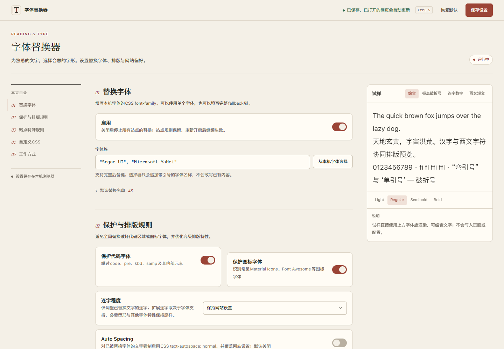

# 字体替换器 · 案头工作台前端

设计与实现日期：2026-10-17。

## 视觉语言

- 三款扩展共用“案头”设计系统：暖纸底色、墨色正文、细线与衬线标题。本扩展主色为朱砂 `#9b4436`，深色模式使用 `#e3a48e`。
- 界面字体通过 `@font-face` 与 `unicode-range` 拆成中西文两组本机别名。中文引号、破折号、省略号、间隔号与全角标点由中文字体排，西文、数字与代码符号由西文字体排；标题使用衬线别名，代码使用等宽别名。
- 颜色令牌集中在 `kit/kit.css`：纸 `#f4f0e7`、纸面 `#fffcf5`、墨 `#211f1b`、次级文字 `#4f4a43`；暗色使用暖黑纸面与米色文字。
- 页面标识、工具栏与扩展管理页沿用同一书籍印记；PNG 提供 16、32、48、128 像素。

## 交互与适配

- 顶部应用栏固定：保存状态、恢复默认与保存设置始终可达，`Ctrl+S` 或 `⌘S` 保存。
- 桌面为三栏：左侧章节目录、中间设置、右侧常驻试样。1024 像素以下隐藏目录，900 像素以下把试样移到设置之前并改为单列。
- 开关、分段选择、自绘下拉、站点规则与代码编辑器由 `kit/` 统一提供，保留原生表单语义、焦点环与键盘操作。
- 支持明暗主题、强制颜色、减少动效、窄屏与 200% 缩放；未保存状态、保存中、成功与失败分别显示。

## 页面结构

1. 替换字体：全局开关、字体族输入、本机字体选择器与目标名单折叠区。
2. 保护与排版：代码保护、图标保护、连字程度与 Auto Spacing。
3. 站点特殊规则：域名、站点行为、三项主覆盖常驻，次要设置折叠；删除后可撤销；本站 CSS 子页保留草稿与返回位置。
4. 自定义 CSS：独立编辑区、默认内容恢复与配额失败提示。
5. 工作方式：四条要点与快捷键。

本机字体选择器通过 `chrome.fontSettings` 读取字体目录，搜索后把带引号的字体名追加到输入框，不改写已有字体链。工具栏弹窗只处理当前站点三态、全局开关与完整设置入口；受保护页面停用本站控件，全局开关仍可保存。

## 页面记录

截图由内置浏览器在本机设置页预览中保存，使用 PNG 格式。扩展 API 在该预览宿主中使用本地存储替身；真实扩展加载、配置及网页行为通过仓库现有 Chromium 回归检查。

- [浅色页面](options-light.png)
- [暗色页面](options-dark.png)
- [390 像素窄屏](options-mobile.png)
- [完整设置页](options-full.png)
- [工具栏弹窗](popup-light.png)

